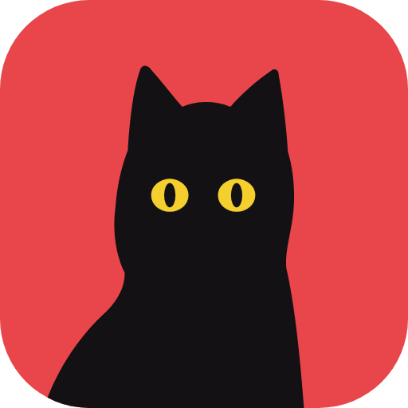

<p align="center"></p>

# BlackCat Print

**Deutsch** · [English](#english)

Direkt drucken auf **PD01**- und ähnliche Bluetooth-Mini-Thermodrucker („Cat Printer“, 57/58-mm-Papier) –
**ohne Konto, ohne App-Store, ohne Cloud, ohne Werbung**. Eine einzige HTML-Seite, die komplett im Browser läuft.

## Benutzen

- **iPhone/iPad:** Safari kann kein Bluetooth. Die Seite in der App **Bluefy** (App Store) öffnen.
- **Android:** Chrome
- **Windows, macOS, Linux:** Chrome oder Edge

Oben auf **Verbinden** tippen, den Drucker auswählen, drucken. Über **EN/DE** in der Kopfzeile wechselst du die Sprache.

## Funktionen

- **Bild oder PDF:** Zuschneiden, Drehen, Foto- oder Grafikmodus, Auto-Kontrast, Invertieren
- **Text:** Schriftart, Größe, Fett, Ausrichtung
- **Vorlagen:** Checkliste, QR-Code, Banner quer über den Streifen, Notiz mit Datum
- Druckstärke Hell / Normal / Kräftig, Kopien, Verlauf zum Nachdrucken
- Druckerstatus (bereit, kein Papier, zu heiß, Akku schwach), heller und dunkler Modus, Deutsch und Englisch

## Unterstützte Drucker

Getestet mit dem **PD01**. Sehr wahrscheinlich auch **MX05–MX13, GB01–03, GT01/02, YT01/02** und Geräte,
die sich als „MINI PRINTER“ melden (384 Punkte Breite). Nicht unterstützt: MXW01, BQ-, P7-, V- und X-Serie
sowie Modelle mit 80-mm-Papier.

## Datenschutz

Keine Konten, keine Analyse, keine Server. Bilder und Texte werden nur im Browser verarbeitet und gehen
direkt per Bluetooth an den Drucker. Einstellungen und Verlauf liegen im lokalen Speicher des Browsers.
Nur für PDFs wird beim ersten Mal der PDF-Leser *pdf.js* von cdnjs geladen.

## Aufbau und Bauen

| Datei | Inhalt |
|---|---|
| `index.html` | fertige Seite (wird von GitHub Pages ausgeliefert) |
| `src/index.src.html` | Quelltext: Oberfläche, Übersetzungen, Bluetooth, Bildverarbeitung |
| `src/qr.js` | QR-Code-Encoder (Byte-Modus, Fehlerkorrektur M) |
| `src/icon/` | Logo als SVG und PNG |
| `src/build.py` | setzt `qr.js` und Logo in die Seite ein und schreibt `index.html` |

Nach Änderungen in `src/` neu bauen (benötigt Python mit Pillow) und `index.html` mit hochladen:

```
python -m pip install pillow
python src/build.py
```

**GitHub Pages:** Settings → Pages → *Deploy from a branch* → `main` / `(root)`.

## Protokoll

Pakete `51 78 | Befehl | 00 | Länge (2 Byte, LE) | Daten | CRC-8 (Polynom 0x07) | FF` an Dienst `ae30`,
Schreiben auf `ae01` (ohne Antwort), Meldungen von `ae02`. Druckablauf: Dichte `F2`, Qualität `A4`,
Energie `AF`, Lattice-Start `A6`, Modus `BE`, Geschwindigkeit `BD`, je Zeile `A2` + 48 Byte (LSB = linker Punkt),
Vorschub `A1`, Lattice-Ende `A6`. Flusskontrolle über `AE` (`10` = Pause), Status über `A3`.

---

<a name="english"></a>

## English

Print directly to **PD01** and similar Bluetooth mini thermal printers ("cat printers", 57/58 mm paper) –
**no account, no app store, no cloud, no ads**. A single HTML page that runs entirely in your browser.

- **iPhone/iPad:** Safari has no Bluetooth support – open the page in the **Bluefy** app.
- **Android:** Chrome · **Windows/macOS/Linux:** Chrome or Edge

Tap **Connect**, pick your printer, print. Use **EN/DE** in the header to switch languages.

Features: images and PDFs (crop, rotate, photo/graphics mode, auto contrast, invert), text, templates
(checklist, QR code, banner across the strip, note with date), strength presets, copies, print history,
printer status, light/dark mode.

Everything is processed locally in the browser; nothing is uploaded anywhere. Only for PDFs is the
*pdf.js* reader loaded from cdnjs on first use.

To rebuild after editing `src/`: `python src/build.py` (requires Pillow), then upload the new `index.html`.

---

Unabhängiges Projekt, nicht verbunden mit den Herstellern der Drucker oder der App „Fun Print“. Das
Bluetooth-Protokoll wurde zur Herstellung der Interoperabilität ermittelt; das Repository enthält keinen
Code und keine Dateien dieser App. · Independent project, not affiliated with the printer makers or the
"Fun Print" app.

## Lizenz / License

[MIT](LICENSE)

## Drittanbieter / Third-party

| Komponente / Component | Lizenz / License | Verwendung / Usage |
|---|---|---|
| [QR Code generator library](https://www.nayuki.io/page/qr-code-generator-library) – Project Nayuki | MIT | `src/qr.js` folgt deren Aufbau; Lizenzhinweis steht in der Datei. · `src/qr.js` follows its structure; the license notice is included in the file. |
| [PDF.js](https://github.com/mozilla/pdf.js) – Mozilla | Apache-2.0 | Wird nur beim Öffnen eines PDFs von cdnjs geladen, nicht mitgeliefert. · Loaded from cdnjs only when a PDF is opened; not included. |
| [Pillow](https://python-pillow.org) | MIT-CMU | Nur für `src/build.py` (Logo einbetten), nicht mitgeliefert. · Only used by `src/build.py`; not included. |

Schriften: Systemschriften des Geräts. Logo und Symbole: eigene Zeichnungen. ·
Fonts: the device's system fonts. Logo and icons: original drawings.
